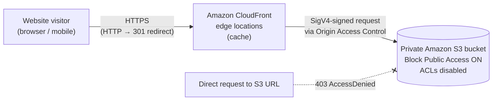

# Sweeft Events: Secure Static Website on Amazon S3 + CloudFront

**Cloud Computing Practical Project 01**

| | |
|---|---|
| **Live site (CloudFront URL)** | https://dXXXXXXXXXXXX.cloudfront.net |
| **GitHub repository** | https://github.com/YOUR-USERNAME/sweeft-events-aws |

---

## 1. Project overview

Sweeft Events is a Lagos-based event-planning business (weddings, social celebrations, corporate events and décor). It needs a professional website that customers in different locations can reach quickly. Hosting should be reliable, secure and cheap, with no web servers to maintain.

The solution is a static website (HTML, CSS, JavaScript and local assets). The files sit in a **private Amazon S3 bucket** and are delivered worldwide through **Amazon CloudFront**. **Origin Access Control (OAC)** makes sure only the CloudFront distribution can read the bucket. Visitors never reach S3 directly, and all traffic is served over HTTPS.

### Website pages

| Brief requirement | Page |
|---|---|
| Homepage | `index.html`: hero video, services overview, gallery highlights, brands, testimonials |
| About Us | `experience.html`: the Sweeft experience and founder story |
| Services | `services.html`: Weddings, Social, Corporate, Décor |
| Contact | `contact.html`: enquiry form, WhatsApp, email, FAQ, map |
| (Extra) Gallery | `gallery.html`: filterable gallery, lightbox and reels |

The site is responsive on desktop and mobile, with fixed navigation, smooth scrolling and animations that respect the device's reduce-motion setting.

---

## 2. Architecture




**Request flow**
1. The visitor opens the CloudFront URL. An HTTP request is redirected to HTTPS.
2. The nearest CloudFront edge location serves the file from its cache if it has it.
3. On a cache miss, CloudFront signs the request to S3 with its OAC.
4. The S3 bucket policy allows `s3:GetObject` only for the CloudFront service principal **and** only when the request comes from this specific distribution (its ARN). Every other request is denied.

---

## 3. AWS services used

| Service | Purpose |
|---|---|
| **Amazon S3** | Stores the website files (origin). Private, encrypted at rest (SSE-S3). |
| **Amazon CloudFront** | Global CDN: caching, low latency, HTTPS, default root object. |
| **AWS Budgets** | Zero-spend budget alert to avoid unexpected costs. |

---

## 4. Implementation steps

### 4.1 S3 bucket
- Bucket name: `BUCKET-NAME`, region `REGION`
- Object Ownership: **Bucket owner enforced (ACLs disabled)**
- Block Public Access: **all four settings ON**
- Default encryption: SSE-S3
- Static website hosting: **disabled**. It is not needed with OAC, and it would require a public bucket.
- Uploaded the *contents* of `site/` so that `index.html` is at the bucket root.

### 4.2 CloudFront distribution
- Origin: the bucket's **REST endpoint** (`BUCKET-NAME.s3.REGION.amazonaws.com`), not the website endpoint
- Origin access: **Origin access control**, signing behaviour *Sign requests*
- Viewer protocol policy: **Redirect HTTP to HTTPS**
- Allowed methods: GET, HEAD
- Cache policy: CachingOptimized
- Default root object: `index.html`

### 4.3 Bucket policy (account ID redacted)

```json
{
  "Version": "2012-10-17",
  "Statement": [
    {
      "Sid": "AllowCloudFrontServicePrincipalReadOnly",
      "Effect": "Allow",
      "Principal": { "Service": "cloudfront.amazonaws.com" },
      "Action": "s3:GetObject",
      "Resource": "arn:aws:s3:::BUCKET-NAME/*",
      "Condition": {
        "StringEquals": {
          "AWS:SourceArn": "arn:aws:cloudfront::XXXXXXXXXXXX:distribution/DISTRIBUTION-ID"
        }
      }
    }
  ]
}
```

## 6. Testing and validation

| # | Test | Method | Result | Evidence |
|---|---|---|---|---|
| 1 | Site reachable via CloudFront | Opened the distribution URL | ✅ | `docs/screenshots/01-site-live.png` |
| 2 | HTTPS works | Padlock / certificate details | ✅ | `02-https.png` |
| 3 | HTTP redirects to HTTPS | `curl -I http://dXXXX.cloudfront.net` → `301` | ✅ | `03-redirect.png` |
| 4 | Images, CSS and JS load | DevTools Network tab: all `200` | ✅ | `04-network.png` |
| 5 | Direct S3 access denied | Opened the S3 object URL → `AccessDenied` | ✅ | `05-s3-denied.png` |
| 6 | CloudFront retrieves from the private origin | `curl -I https://dXXXX.cloudfront.net/index.html` → `200`, `x-cache` header | ✅ | `06-cloudfront-200.png` |
| 7 | Responsive on mobile | DevTools device mode / phone | ✅ | `07-mobile.png` |
| 8 | Updates propagate | Edited the page, re-uploaded, created invalidation `/*` → change visible | ✅ | `08-update-before.png`, `09-invalidation.png`, `10-update-after.png` |
---

## 8. Challenges encountered and resolutions


---

## 9. Lessons learned

---
## 10. Cost and clean-up

- Monitored usage with an AWS Budgets zero-spend alert. The project stays within the free tier.
- After assessment: disable and delete the CloudFront distribution, delete the OAC, empty and delete the S3 bucket.

## Repository structure

```
sweeft-events-aws/
├── site/                 ← website files (the contents of this folder are uploaded to S3)
│   ├── index.html, services.html, experience.html, gallery.html, contact.html
│   ├── css/  js/  fonts/  assets/
├── docs/
│   ├── architecture.png
│   ├── screenshots/
│   └── site-handover-notes.md
├── .gitignore
└── README.md
```
