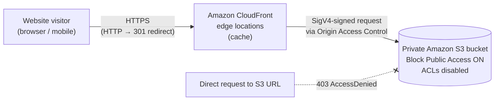

# Sweeft Events: Secure Static Website on Amazon S3 + CloudFront

**Cloud Computing Practical Project 01**

| | |
|---|---|
| **Live site (CloudFront URL)** | https://dXXXXXXXXXXXX.cloudfront.net |
| **GitHub repository** | https://github.com/YOUR-USERNAME/sweeft-events-aws |

---

## 1. Project overview

Sweeft Events is a Lagos-based event-planning business (weddings, social celebrations, corporate events and décor). It needs a professional website that customers in different locations can reach quickly. Hosting should be reliable, secure and cheap, with no web servers to maintain.

The solution is a static website (HTML, CSS, JavaScript and local assets). The files sit in a **private Amazon S3 bucket** and are delivered worldwide through **Amazon CloudFront**. **Origin Access Control (OAC)** makes sure only the CloudFront distribution can read the bucket. Visitors never reach S3 directly, and all traffic is served over HTTPS.

### Website pages

| Brief requirement | Page |
|---|---|
| Homepage | `index.html`: hero video, services overview, gallery highlights, brands, testimonials |
| About Us | `experience.html`: the Sweeft experience and founder story |
| Services | `services.html`: Weddings, Social, Corporate, Décor |
| Contact | `contact.html`: enquiry form, WhatsApp, email, FAQ, map |
| (Extra) Gallery | `gallery.html`: filterable gallery, lightbox and reels |

The site is responsive on desktop and mobile, with fixed navigation, smooth scrolling and animations that respect the device's reduce-motion setting.

---

## 2. Architecture




**Request flow**
1. The visitor opens the CloudFront URL. An HTTP request is redirected to HTTPS.
2. The nearest CloudFront edge location serves the file from its cache if it has it.
3. On a cache miss, CloudFront signs the request to S3 with its OAC.
4. The S3 bucket policy allows `s3:GetObject` only for the CloudFront service principal **and** only when the request comes from this specific distribution (its ARN). Every other request is denied.

---

## 3. AWS services used

| Service | Purpose |
|---|---|
| **Amazon S3** | Stores the website files (origin). Private, encrypted at rest (SSE-S3). |
| **Amazon CloudFront** | Global CDN: caching, low latency, HTTPS, default root object. |
| **CloudFront Origin Access Control (OAC)** | Lets CloudFront sign requests to the private bucket. |
| **HTTPS / TLS** | Default `*.cloudfront.net` certificate. HTTP is redirected to HTTPS. |
| **AWS Budgets** | Zero-spend budget alert to avoid unexpected costs. |

No EC2 instances, no custom domain.

---

## 4. Implementation steps

### 4.1 S3 bucket
- Bucket name: `BUCKET-NAME`, region `REGION`
- Object Ownership: **Bucket owner enforced (ACLs disabled)**
- Block Public Access: **all four settings ON**
- Default encryption: SSE-S3
- Static website hosting: **disabled**. It is not needed with OAC, and it would require a public bucket.
- Uploaded the *contents* of `site/` so that `index.html` is at the bucket root.

### 4.2 CloudFront distribution
- Origin: the bucket's **REST endpoint** (`BUCKET-NAME.s3.REGION.amazonaws.com`), not the website endpoint
- Origin access: **Origin access control**, signing behaviour *Sign requests*
- Viewer protocol policy: **Redirect HTTP to HTTPS**
- Allowed methods: GET, HEAD
- Cache policy: CachingOptimized
- Default root object: `index.html`

### 4.3 Bucket policy (account ID redacted)

```json
{
  "Version": "2012-10-17",
  "Statement": [
    {
      "Sid": "AllowCloudFrontServicePrincipalReadOnly",
      "Effect": "Allow",
      "Principal": { "Service": "cloudfront.amazonaws.com" },
      "Action": "s3:GetObject",
      "Resource": "arn:aws:s3:::BUCKET-NAME/*",
      "Condition": {
        "StringEquals": {
          "AWS:SourceArn": "arn:aws:cloudfront::XXXXXXXXXXXX:distribution/DISTRIBUTION-ID"
        }
      }
    }
  ]
}
```

---

## 5. Security considerations

- **Private bucket:** Block Public Access stays on and there are no public ACLs or public policy statements.
- **Least privilege:** only `s3:GetObject` is granted, only to CloudFront, and only for this one distribution (`AWS:SourceArn` condition). This prevents the "confused deputy" problem, where another CloudFront distribution could otherwise read the bucket.
- **OAC instead of legacy OAI:** OAC uses SigV4 signing, supports SSE-KMS and all regions, and is AWS's current recommendation.
- **Encryption in transit:** HTTPS is enforced by the HTTP→HTTPS redirect.
- **Encryption at rest:** SSE-S3 is the bucket default.
- **No secrets in the repo:** no access keys or credentials. `.gitignore` excludes credential files, and the account ID is redacted in screenshots and docs. The only "contact" values in `js/config.js` are the business's public email and WhatsApp number.
- **No servers:** there is nothing to patch, which reduces the attack surface.

---

## 6. Testing and validation

| # | Test | Method | Result | Evidence |
|---|---|---|---|---|
| 1 | Site reachable via CloudFront | Opened the distribution URL | ✅ | `docs/screenshots/01-site-live.png` |
| 2 | HTTPS works | Padlock / certificate details | ✅ | `02-https.png` |
| 3 | HTTP redirects to HTTPS | `curl -I http://dXXXX.cloudfront.net` → `301` | ✅ | `03-redirect.png` |
| 4 | Images, CSS and JS load | DevTools Network tab: all `200` | ✅ | `04-network.png` |
| 5 | Direct S3 access denied | Opened the S3 object URL → `AccessDenied` | ✅ | `05-s3-denied.png` |
| 6 | CloudFront retrieves from the private origin | `curl -I https://dXXXX.cloudfront.net/index.html` → `200`, `x-cache` header | ✅ | `06-cloudfront-200.png` |
| 7 | Responsive on mobile | DevTools device mode / phone | ✅ | `07-mobile.png` |
| 8 | Updates propagate | Edited the page, re-uploaded, created invalidation `/*` → change visible | ✅ | `08-update-before.png`, `09-invalidation.png`, `10-update-after.png` |

### Configuration evidence
- `11-s3-block-public-access.png`
- `12-s3-object-ownership.png`
- `13-s3-bucket-policy.png`
- `14-cloudfront-origin-oac.png`
- `15-oac-details.png`
- `16-cloudfront-behavior-https.png`
- `17-default-root-object.png`

---

## 7. Implementation decisions

- **Static site + S3 + CloudFront instead of EC2:** there are no servers to run or patch, it scales automatically and it costs almost nothing.
- **REST endpoint instead of the S3 website endpoint:** OAC only works with the REST endpoint, and the website endpoint would need a public bucket.
- **Multi-page site:** the content is grouped into separate pages (Services, Experience/About, Gallery, Contact) to match the client's Figma design, linked by a shared fixed navigation bar.
- **Self-hosted fonts, images and videos:** every asset is served through CloudFront, so pages load consistently and there are no third-party font requests.
- **Serverless contact form:** enquiries are sent through FormSubmit, with a WhatsApp fallback, so no backend is needed.

---

## 8. Challenges encountered and resolutions

> Fill this in with what actually happened during deployment.

| Challenge | Cause | Resolution |
|---|---|---|
| _e.g. Old version still showing after re-upload_ | _CloudFront edge cache_ | _Created an invalidation for `/*`_ |
| | | |

---

## 9. Lessons learned

> Your own reflections, e.g. how OAC and bucket policies work together, why caching needs invalidation, how a CDN improves latency for users in different regions.

---

## 10. Cost and clean-up

- Monitored usage with an AWS Budgets zero-spend alert. The project stays within the free tier.
- After assessment: disable and delete the CloudFront distribution, delete the OAC, empty and delete the S3 bucket.

## Repository structure

```
sweeft-events-aws/
├── site/                 ← website files (the contents of this folder are uploaded to S3)
│   ├── index.html, services.html, experience.html, gallery.html, contact.html
│   ├── css/  js/  fonts/  assets/
├── docs/
│   ├── architecture.png
│   ├── screenshots/
│   └── site-handover-notes.md
├── .gitignore
└── README.md
```
